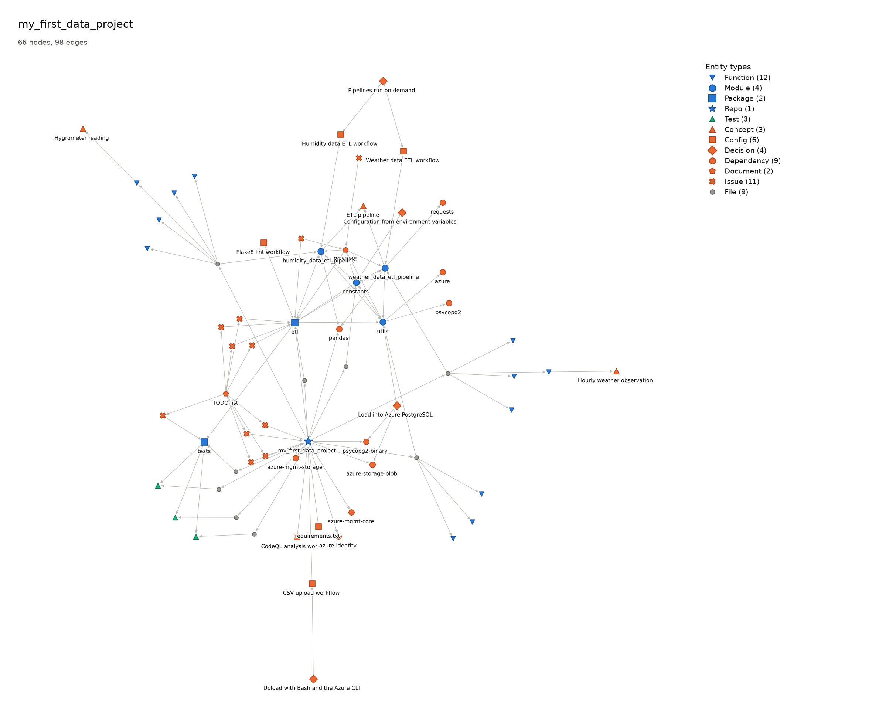

# kg — turn a codebase into a knowledge graph

[](https://github.com/Cristian1A/kg/actions/workflows/ci.yml)

`kg` is a command-line tool, for humans and AI agents, that turns what a
software project knows about itself — code, dependencies, docs, tests, design
decisions — into a **knowledge graph** you can query, visualize and export.

The graph lives inside the repo (`.kg/graph.json`), as readable, deterministic
JSON that is versioned with git like any other file.

> **Status: v0.2, the evidence phase.** The MVP (schema, store, extraction,
> rendering, agent guide) is done, and `kg query` / `kg impact` answer
> questions over the graph. A benchmark measured whether the graph helps an
> agent. On small repos, an agent that reads node cards (`--brief`) and then
> only the lines they cite is as accurate as one reading the code, with 63% less
> context ([report](docs/benchmark.md)). When the graph is stale, the agent
> reads the files `kg status` reports as changed, so it still answers, but it
> costs more than reading the code. See the [roadmap](#roadmap).

## Why

- **Ask real questions about a project.** Which code has no tests? Is the
  documentation in line with the code? Where would these new requirements
  fit? An agent can answer them reliably when it reasons over a graph instead
  of grepping files.
- **Two ways in, one graph.** A deterministic parser extracts the structure
  (files, modules, functions, imports, dependencies), and an external agent
  adds what only a reader understands (docs, decisions, concepts). Both write
  the same JSON format and are merged by stable IDs.
- **Built for agents.** Every command has `--json` output, and validation
  errors carry a JSON path, the received and expected values and a suggestion,
  so an agent can fix its own output in one iteration.
- **Traceable.** Every node and edge records its provenance: where it came
  from, how (`parser`, `llm`, `manual`) and with what confidence.
- **Offline and LLM-free.** `kg` never calls a model or sends data anywhere.
  Agents use it as a tool.

## Install

Requires Python ≥ 3.12 (Linux). Not on PyPI yet, so install it from GitHub.

**To use it**, with [pipx](https://pipx.pypa.io/) (an isolated environment, and
`kg` on your `PATH`):

```bash
pipx install git+https://github.com/Cristian1A/kg.git
kg --help
```

or with pip inside a virtual environment:

```bash
python -m venv .venv && source .venv/bin/activate
pip install git+https://github.com/Cristian1A/kg.git
```

Static images (`kg render --png`/`--svg`) of 500 nodes or more also need
`scipy` (`pipx inject kg scipy`, or `pip install scipy`); see
[docs/render.md](docs/render.md).

**To work on it**, clone the repo and install it in editable mode with the
development tools:

```bash
git clone https://github.com/Cristian1A/kg.git
cd kg
python -m venv env && source env/bin/activate
pip install -e ".[dev]"
kg --help
```

## Quick start

```bash
kg init                            # create .kg/graph.json in the current repo
kg extract .                       # the parser maps code, tests and dependencies
kg guide                           # guidelines for the agent that adds the rest
kg add agent.json --dry-run --json # the agent checks its document against the store
kg add agent.json                  # merge docs, decisions and concepts
kg render --html                   # kg-graph.html: search, filter, click for details
kg query node module:app.core      # a node and its neighbors; also find, path
kg impact function:app.core.run    # what a change may affect, with the edges why
kg status                          # later: has the code changed since the extract?
```

`kg extract` is deterministic and needs no LLM. Run it again after changing
the code: it updates what the parser found and removes what is gone, without
touching what the agent added. Documents, design decisions
and domain concepts come from an external agent (Claude Code, Codex…) that
follows `kg guide` (also installable as a skill with `kg guide --skill`) and
the JSON Schema (`kg schema`). [`examples/agent/kg.json`](examples/agent/kg.json)
is what an agent added for this repo.

A minimal input document:

```json
{
  "version": "1",
  "nodes": [
    {
      "id": "function:size.main",
      "type": "Function",
      "label": "main",
      "provenance": { "method": "parser", "extractor": "python-ast@0.1", "confidence": 1.0 }
    },
    {
      "id": "document:README.md",
      "type": "Document",
      "provenance": { "method": "llm", "extractor": "claude-code", "confidence": 0.8 }
    }
  ],
  "edges": [
    {
      "source": "document:README.md",
      "target": "function:size.main",
      "type": "documents",
      "provenance": { "method": "llm", "extractor": "claude-code", "confidence": 0.7 }
    }
  ]
}
```

When something is wrong, `kg` says exactly what and how to fix it:

```text
$ kg validate graph.json
error: graph.json is not valid: 1 error
error: $.edges[0].target: the edge points to a node that does not exist in the file
  received:   "function:size.mian"
  expected:   the ID of a node declared in `nodes`
  suggestion: Did you mean "function:size.main"? Fix the ID or add the node to `nodes`.
```

Adding the same document twice changes nothing, and conflicts are reported:

```text
$ kg add graph.json
graph.json merged into .kg/graph.json
  nodes: 1 added, 1 merged, 0 unchanged
  edges: 1 added, 0 merged, 0 unchanged
  1 conflict:
    function:size.main · label: "main" → "main(file)"
```

## Examples

We built a graph for each of five projects, from a one-file CLI to scrapy.
Each graph combines `kg extract` with the documents, decisions and concepts
an agent added following `kg guide`. Open the interactive pages, offline HTML
with search, filters and details on click:

| Level | Project | Nodes / edges | Interactive graph |
|-------|---------|---------------|-------------------|
| Easy | [alfredodeza/basic-python-cli](https://github.com/alfredodeza/basic-python-cli) | 10 / 12 | [basic-python-cli](https://cristian1a.github.io/kg/examples/basic-python-cli.html) |
| Intermediate | [bramvdklinkenberg/my_first_data_project](https://github.com/bramvdklinkenberg/my_first_data_project) | 66 / 98 | [my_first_data_project](https://cristian1a.github.io/kg/examples/my_first_data_project.html) |
| Complex | [wesleey/python-clean-architecture](https://github.com/wesleey/python-clean-architecture) | 398 / 754 | [python-clean-architecture](https://cristian1a.github.io/kg/examples/python-clean-architecture.html) |
| Self | `kg` itself | 904 / 1889 | [kg](https://cristian1a.github.io/kg/examples/kg.html) |
| Large | [scrapy/scrapy](https://github.com/scrapy/scrapy) 2.19.0 | 7964 / 18239 | [scrapy](https://cristian1a.github.io/kg/examples/scrapy.html) (8 MB) |

`kg render --png` of `my_first_data_project` shows:
- the ETL modules (blue);
- the CI workflows, decisions, concepts and TODO items an agent found (orange);
- the empty test files (green).



The images of the other four projects, with the types each one shows, are in
[docs/examples](docs/examples/README.md). Thanks to the authors of these
projects. Credits, commits and license texts are in the same file, and the
validation report is in [docs/mvp-validation.md](docs/mvp-validation.md).

## Data model

- **Nodes** have a stable ID `<type>:<path|qualified name|slug>`
  (`file:src/app/main.py`, `function:app.main.run`, `decision:use-networkx`).
- **Standard catalog** of entity types (`Repo`, `Module`, `File`, `Function`,
  `Dependency`, `Test`, `Document`, `Decision`, `Concept`…) and relation types
  (`contains`, `imports`, `defines`, `calls`, `documents`, `tests`,
  `justifies`…). Custom types are allowed and produce a warning.
- The graph is an `nx.MultiDiGraph`; an edge is identified by
  (`source`, `target`, `type`).

Details in [docs/schema.md](docs/schema.md), [docs/store.md](docs/store.md),
[docs/extract.md](docs/extract.md) and [docs/render.md](docs/render.md).

## Roadmap

| Command | What it does | Status |
|---------|--------------|--------|
| `kg schema` | Print the input JSON Schema | ✅ |
| `kg validate` | Validate a document with actionable errors | ✅ |
| `kg init` | Create the `.kg/` store | ✅ |
| `kg add` | Merge a document into the store by ID (`--dry-run` to check first) | ✅ |
| `kg guide` | Guidelines (and skill) for agents that enrich the graph | ✅ |
| `kg remove`, `kg edit` | Remove nodes or edges, modify a node | ✅ |
| `kg extract` | Deterministic extraction of a Python repo; reruns follow code changes | ✅ |
| `kg status` | Whether the graph is up to date with the code | ✅ |
| `kg render` | PNG/SVG image and interactive offline HTML | ✅ |
| `kg query`, `kg impact` | Find nodes, neighbors, paths, untested/undocumented code, impact of a change | ✅ |
| Benchmark | Measure whether the graph improves an agent's answers ([report](docs/benchmark.md)) | ✅ |
| `kg export` | Mermaid and Graphviz DOT | v0.3 |
| MCP server | Expose the operations as agent tools | v0.3 |

v0.2 is a short evidence phase: queries, a graph that stays consistent with
the code, and a benchmark of an agent with and without the graph. Its
[report](docs/benchmark.md) sets the order of v0.3: first a benchmark on a
large repo, then keeping the graph fresh and checking documents against
code. Plan: [docs/roadmap.md](docs/roadmap.md). Full
requirements: [docs/requirements.md](docs/requirements.md).

## Contributing

See [CONTRIBUTING.md](CONTRIBUTING.md) (Conventional Commits, branch naming,
issue templates) and [AGENTS.md](AGENTS.md) for rules that AI coding agents
follow in this repo.

```bash
pytest && ruff check . && ruff format --check .
.github/smoke-test.sh   # the full flow with the installed kg
```

CI runs the same checks on every push and pull request, plus a clean,
non-editable install with the smoke test.

## License

[MIT](LICENSE)
