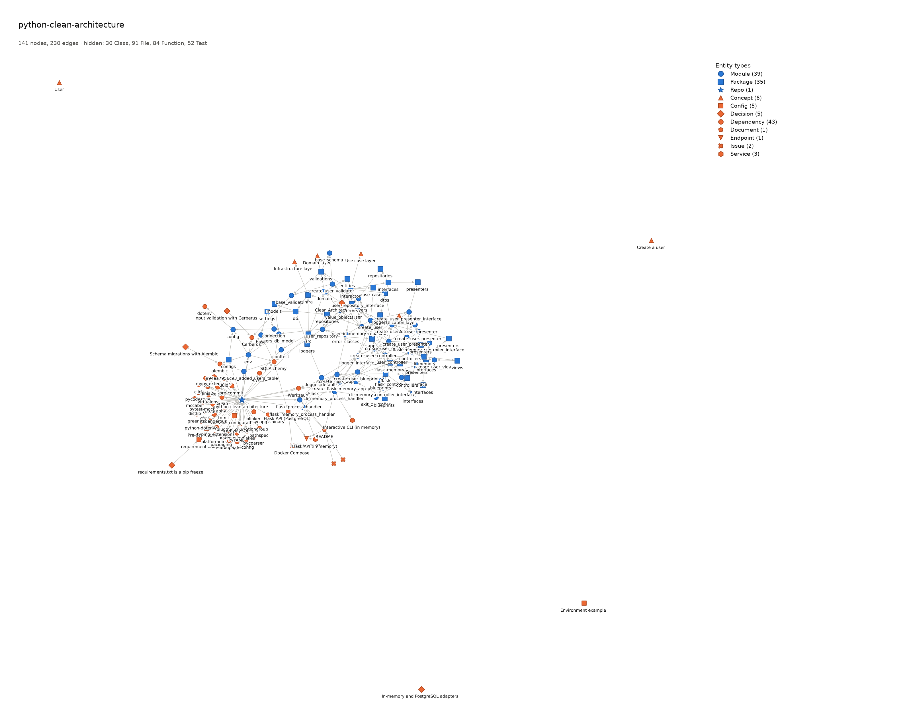
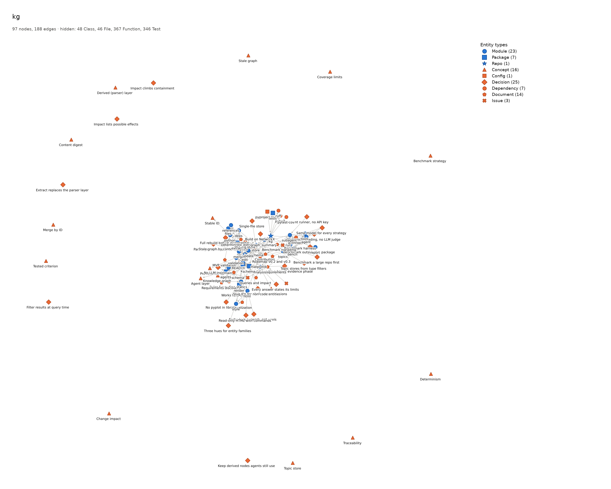
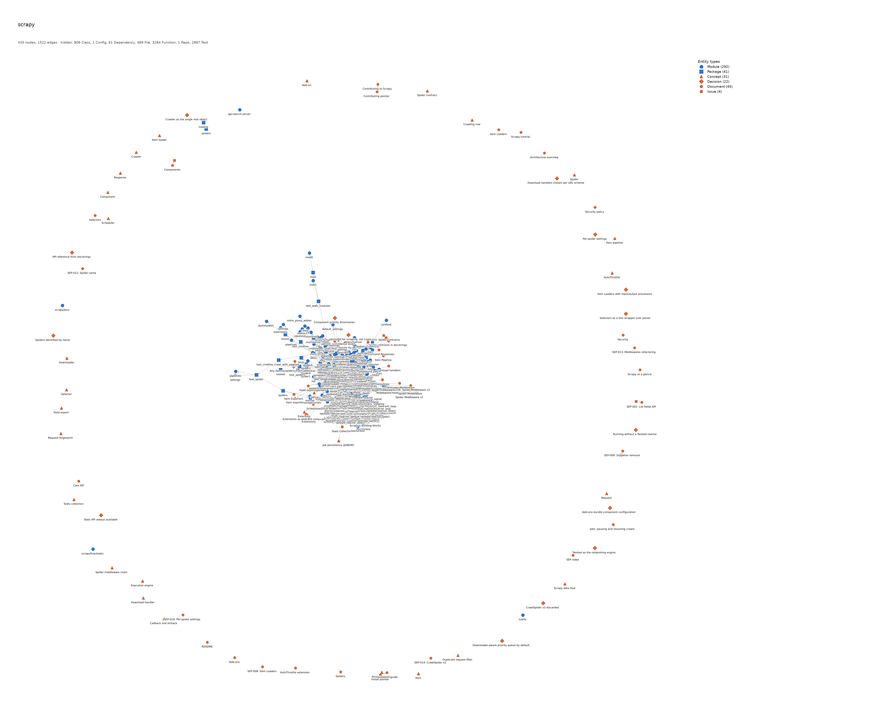

# Example graphs

Knowledge graphs built with `kg` for five projects, first for the MVP
validation (#12, [report](../mvp-validation.md)) and rebuilt with the current
`kg` (#53). Each page is a single offline HTML file: open it in a browser,
search, filter by type and click a node for its details and provenance. They
are also served with GitHub Pages at
`https://cristian1a.github.io/kg/examples/<project>.html`.

| Level | Project | Graph | Image | Nodes / edges | Agent layer |
|-------|---------|-------|-------|---------------|-------------|
| Easy | [alfredodeza/basic-python-cli](https://github.com/alfredodeza/basic-python-cli) | [basic-python-cli.html](basic-python-cli.html) | [png](basic-python-cli.png) | 10 / 12 | 6 nodes |
| Intermediate | [bramvdklinkenberg/my_first_data_project](https://github.com/bramvdklinkenberg/my_first_data_project) | [my_first_data_project.html](my_first_data_project.html) | [png](my_first_data_project.png) | 66 / 98 | 25 nodes |
| Complex | [wesleey/python-clean-architecture](https://github.com/wesleey/python-clean-architecture) | [python-clean-architecture.html](python-clean-architecture.html) | [png](python-clean-architecture.png) | 398 / 754 | 22 nodes |
| Self | `kg` (this repo) | [kg.html](kg.html) | [png](kg.png) | 904 / 1889 | 58 nodes |
| Large | [scrapy/scrapy](https://github.com/scrapy/scrapy) | [scrapy.html](scrapy.html) | [png](scrapy.png) | 7964 / 18239 | 102 nodes |

Each graph combines `kg extract` (code, tests, dependencies) with the
documents, decisions, concepts and issues an agent (Claude Code) added
following `kg guide`. The agent's input is in
[`examples/agent/`](../../examples/agent/).

## Images

The static images hide the most numerous types (see
[render.md](../render.md#large-graphs)), so they are an overview. For details,
use the HTML.

- **python-clean-architecture:** the default (`kg render --png`). Classes,
  files, functions and tests are hidden.
- **kg:** repo, packages, modules, dependencies and the agent layer
  (`--types Repo,Package,Module,Dependency,Config,Decision,Concept,Document,Issue`).
  The concepts that only functions implement appear unconnected.
- **scrapy:** packages, modules and the agent layer
  (`--types Package,Module,Decision,Concept,Document,Issue --max-nodes 500`).
  With 435 nodes the centre is dense, and the agent nodes that point to classes
  appear unconnected. A static image of a graph this size is only a rough
  overview; the HTML starts with the four largest types hidden.







## Credits and licenses

The graphs describe these projects: file paths, names, docstrings and what
their documentation says. We thank their authors:

| Project | Author | Commit used | License |
|---------|--------|-------------|---------|
| basic-python-cli | Alfredo Deza ([@alfredodeza](https://github.com/alfredodeza)) | `d0379bb` | MIT, © 2022 Alfredo Deza — [text](licenses/basic-python-cli.txt) |
| my_first_data_project | Bram van den Klinkenberg ([@bramvdklinkenberg](https://github.com/bramvdklinkenberg)) | `3d57177` | MIT — [text](licenses/my_first_data_project.txt) (the original leaves the copyright line as the template's `[year] [fullname]`) |
| python-clean-architecture | Wesley Barbosa ([@wesleey](https://github.com/wesleey)) | `6f58de5` | MIT, © 2024 Wesley Barbosa — [text](licenses/python-clean-architecture.txt) |
| kg | Cristian A. Vlad | `e18f574` | MIT — [text](../../LICENSE) |
| scrapy | Scrapy developers ([AUTHORS](https://github.com/scrapy/scrapy/blob/2.19.0/AUTHORS)) | `8026dee` (2.19.0) | BSD-3-Clause, © Scrapy developers — [text](licenses/scrapy.txt) |

The pages themselves are generated by `kg` and embed
[vis-network](https://github.com/visjs/vis-network) 9.1.2 (Apache-2.0 / MIT).

## Regenerating

Clone each project into `samples/` at the commit above (see
[samples/README.md](../../samples/README.md)), then:

```bash
kg init --kg-dir samples/runs/<repo>/.kg
kg extract samples/<repo> --kg-dir samples/runs/<repo>/.kg
kg add examples/agent/<repo>.json --kg-dir samples/runs/<repo>/.kg
kg render --html --kg-dir samples/runs/<repo>/.kg -o docs/examples/<repo>.html
kg render --png --kg-dir samples/runs/<repo>/.kg -o docs/examples/<repo>.png  # plus the --types above
```
