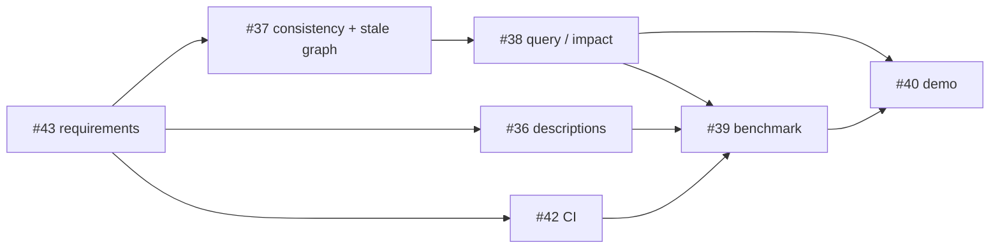

# Roadmap: v0.2 and v0.3

Action plan for the releases after the MVP. The requirements behind each step
are in [requirements.md](requirements.md) (section 7 and section 8.2); this
document covers the **order**, the dependencies and the exit criteria.

> **Status: closed (#69).** v0.2 shipped. v0.3 stopped after its first
> experiment; see [How v0.3 ended](#how-v03-ended).

## Where we are

The MVP (v0.1) is complete and validated on three public repos plus `kg`
itself ([mvp-validation.md](mvp-validation.md)). It shows that `kg` **works**.
It does not yet show that the graph **helps**: that an agent answers better,
or more cheaply, with the graph than by reading the code.

## v0.2 — evidence

**Goal:** go from "an MVP that works on three repos" to evidence about whether
kg solves a problem, and where it does not. The goal is not to make kg a
bigger platform.

**Time box:** about two weeks of work, adapted to availability. If the phase
runs over, cut the stretch items and the extra benchmark variants. Do not
extend the time box.

### Order

| Step | Issue | What | Requirements | Depends on | Why at this point |
|------|-------|------|--------------|------------|-------------------|
| 0 | #43 | Re-scope the requirements and write this plan | — | — | Fixes the scope before any code |
| 1 | #42 | CI, user install, tests for untested edge cases | RNF-03, RNF-07 | — | Small; protects every later change |
| 2 | #37 | Keep the graph consistent with the code; detect a stale graph | RF-72, RF-77 | — | Queries over a stale graph give wrong answers; the benchmark compares commits |
| 3 | #38 | `kg query` and `kg impact`, the minimum the benchmark needs | RF-40–43 | #37 (better results) | The graph agent needs a query interface, not raw JSON |
| 4 | #36 | Mandatory descriptions for agent-created nodes | RF-20 | — | Changes graph quality, so it should land before measuring |
| 5 | #39 | Benchmark: pilot with ~5 questions, then 15–30 | RNF-10 | #38 | The goal of the phase. The pilot checks the harness (prompts, grading, token counting) before writing every question |
| 6 | #40 | Reproducible demo: the README's *Ask the graph*, on a published example | CU-01–05 | #38 | Shows the result to someone who has not followed the project |

Steps 1, 2 and 4 are independent and can overlap. Step 5 starts as soon as #38
has the queries the questions need. The rest of #38 can be finished during the
pilot.

### Benchmark design (#39)

- **Strategies:** the same agent and model, with access to the code
  (baseline) or to the graph and `kg query`/`kg impact`.
- **Repos:** the three repos in `docs/examples/` plus `kg`.
- **Variants:**
  - the full graph vs. **topic-specific** subsets (documentation, tests,
    development, technical decisions), built with the type filters of RF-40;
  - **two commits** of the same repo (old and recent), including a graph from
    the old commit queried about the recent code. This measures the cost of a
    stale graph and whether the RF-77 warning prevents wrong claims.
- **Metrics:** accuracy, traceability (claims backed by IDs or files), input
  and output tokens, time, and questions without an answer. Quality and cost
  are reported separately.
- **Placement:** outside the `kg` package (e.g. `bench/`), because it calls an
  LLM (RF-24, RNF-10).

### Stretch (only if time is left)

- **Start-up time** (RNF-06): import matplotlib lazily, aiming for start-up
  under 0.5 s. About half of every command's time today is start-up.
  Issue to open.
- **Fewer false positives in "untested"** (RF-42): count a call to a class as
  testing its `__init__`, and handle abstract classes (see
  [mvp-validation.md](mvp-validation.md#findings)). Can be folded into #38.

### Exit

v0.2 is done when the criteria in section 8.2 of the requirements are met. The
**decision point** is the benchmark report. It answers:

1. On which kinds of questions (structure, dependencies, tests, docs,
   decisions) does the graph help, and on which does it not?
2. Do topic-specific graphs beat the full graph?
3. How much does a stale graph hurt?
4. Is `kg impact` precise enough with `imports` alone, or does it need `calls`
   (RF-13)?

These answers set the order of v0.3. They are in the
[benchmark report](benchmark.md#answers-to-the-exit-questions).

## v0.3 — tentative

The scope is **reviewed at the v0.2 exit**. The order below is a starting
point: each item says which benchmark result would move it up or down.

| Priority | Item | Requirements | Issue | Moves up if… | Moves down if… |
|----------|------|--------------|-------|--------------|----------------|
| 1 | MCP server | RF-23 | to open | the benchmark shows the graph helps agents: MCP is the natural way for them to use it | the graph adds no value to agents |
| 2 | `calls` relations | RF-13 | to open | `kg impact` misses effects in the benchmark (step 4 of the exit) | `imports` is enough |
| 3 | Topic views | RF-44 | to open | focused graphs beat the full graph | they do not |
| 4 | Multiple provenance, deduplication, conflict policy | RF-31–33 | to open | duplicated entities (e.g. `yaml` vs. `PyYAML`) cause wrong answers | — |
| 5 | Mermaid and DOT export | RF-60–61 | to open | the demo or the users need diagrams in READMEs (CU-06) | — |
| 6 | Hook, history, incremental extraction | RF-73, RF-74, RF-78 | to open | full updates (RF-72) become slow, or the commit comparison proves useful | full updates stay fast |
| 7 | Large graphs in the HTML | RF-51, RF-53 | #35 | the demo uses a large repo | — |
| 8 | Clearer warnings for custom types | RF-02 | #18 | — | — |
| 9 | Dockerfile | RNF-03 | to open | someone needs it to run the demo or the benchmark | — |
| — | Project site or hosted app | — | #41 | the demo needs a public entry point | — (needs an exception to section 9 if it is a hosted app) |

If the benchmark shows that the graph does **not** help, v0.3 does not follow
this table: it starts with a redesign based on the cases where the graph
failed.

## How v0.3 ended

v0.3 began with the large-repo benchmark, as planned, and stopped there. The
whole account is in the [write-up](report.md).

- **The first scrapy run (#52).** On a 489-file repository, reading the code
  won on every measure but total tokens.
- **The redesign (#67).** An unofficial review proposed a redesign in steps,
  each with a numeric kill criterion. Step 0 made kg's reads six times faster
  and gave the agent the graph next to search.
- **The gate failed on time.** The agent was as accurate with the graph and
  read half as much where it used it, but took 45% longer. A control showed
  the rest of the saving came from a prompt line, not the graph.

Following the plan's own rule, kg is not developed further as a code-graph
tool for agents. None of the table above was started, and the issues opened
for it (#35, #55, #60, #66) are left for the maintainer to close or keep.

## After approval

Once version 1.2 is approved:

- [x] Create the `v0.3` milestone and the `prio:v0.3` label.
- [x] Move #35 and #18 to v0.3.
- [ ] Open the v0.3 issues marked "to open" when v0.3 starts, not before: their
      order depends on the benchmark.
